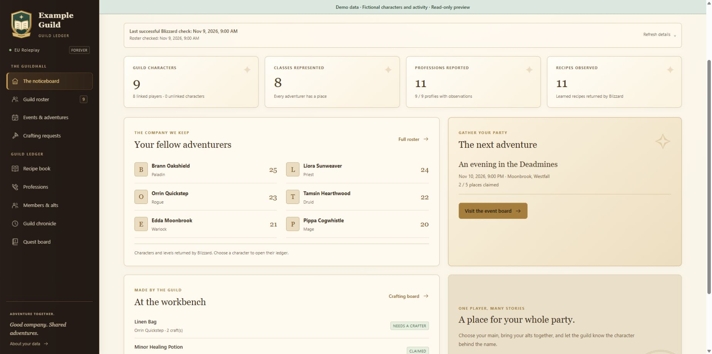
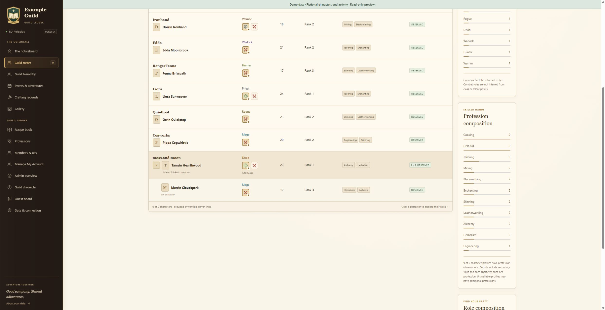
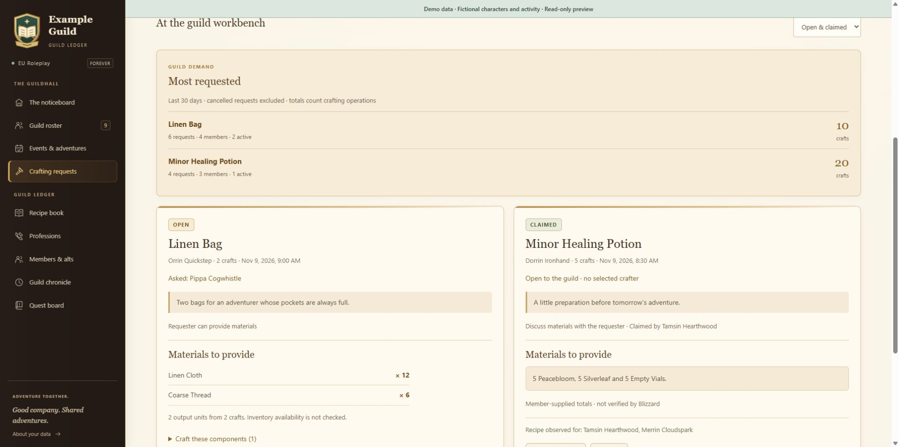
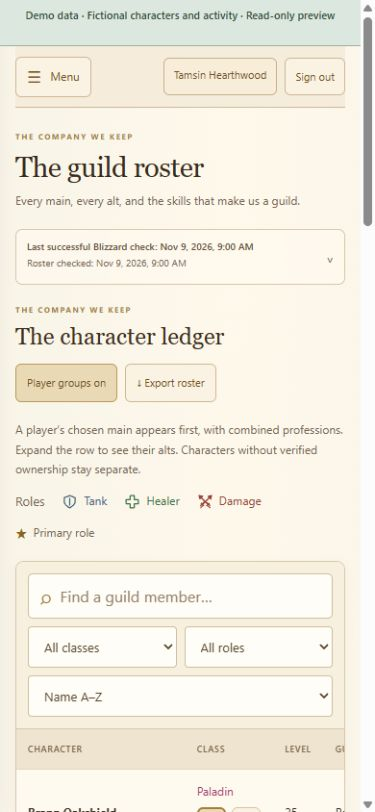

# WoW Forever Guild Tracker

A customisable guild ledger for **World of Warcraft Forever**: a public welcome page and a Battle.net-gated guild dashboard, with a warm tavern theme that works on phones.

[](https://github.com/TechKno/wow-forever-guild-tracker/actions/workflows/ci.yml)
[](LICENSE)

## See the interface

The screenshots below use **fictional demo data**. No live guild members, account identifiers, Discord identities, requests or events are shown.





<details>
<summary>Phone layout</summary>



</details>

Screenshots are captured from the real interface using the isolated [demo preview](#try-the-interface-with-demo-data), with fictional names and activity substituted before rendering. See [screenshot provenance](docs/screenshots/README.md).

## Features

- Roster with class/profession composition, main/alt grouping, sorting and filters for primary **or additional** combat roles.
- Members choose multiple roles per character and one primary. Only verified owners can edit them.
- Character talent details, profession skills, observed recipes and crafting materials, including known component recipes.
- Craft requests with selected crafters, optional Discord DMs, a fallback channel and completion reactions.
- Dungeon/event planning, party roles, Discord announcements and cleanup of completed/cancelled posts.
- Dated character changes and individual recipe observations; identical refreshes do not clutter the log.
- Chronicle entries include verified roster level-ups and newly observed members, even when character profiles are unavailable. Dates are observation times, not exact in-game level-up or join times.
- Discord display names, administrator-managed character mappings and member roleplay profiles.
- Battle.net ownership plus current guild membership, administrator-only settings, CSRF/origin checks and rate limits.

## Choose your hosting

| Route | What you need | Guide |
| --- | --- | --- |
| Cloudflare Workers + D1 | Cloudflare account, your Battle.net developer client and an HTTPS site address | [Cloudflare deployment](docs/CLOUDFLARE.md) |
| Your server / Docker | Docker Compose, persistent storage, a domain and HTTPS through Caddy | [Self-hosting](docs/SELF-HOSTING.md) |

Each installation is for **one guild** and has its own database, provider client and optional Discord bot. Do not point another guild at an existing installation's database.

## Make it your guild

1. Use this repository as a template, fork it or clone it.
2. Install Node.js 24 or newer and run `npm ci`.
3. Edit [`guild.config.json`](guild.config.json): guild name/slug, region, ruleset, HTTPS origin, text, colours, images and bot name.
4. Run `npm run build` to regenerate the site from its branding templates.
5. Follow the hosting guide you selected above.

See [customisation](docs/CUSTOMISATION.md) and [Discord setup](docs/DISCORD.md) for the complete settings and callback URLs. Credentials belong in your host's encrypted secrets or private secret files. The tracked example files contain no working credentials.

## Try the interface with demo data

```sh
npm ci
npm run build
npm run demo
```

Open the loopback URL printed by the demo server. This is a read-only interface preview with fictional data; it does not contact Blizzard or Discord, load a production database or enable a production login bypass.

## Development and checks

```sh
npm run build
npm run check
npm test
npm run check:release
```

The test suite covers import/refresh behavior, identity and membership checks, ownership, CSRF, custom configuration, crafting/event delivery, role filtering, dated history, the mobile interface and the self-host adapter. CI tests Node.js 24 and 26 and builds the Docker image. No provider credentials are needed for tests.

## API coverage and limitations

This targets **Forever**, rather than Retail, Classic Era or private-server APIs. EU Roleplay was the original integration. Other configurable Forever regions/rulesets have synthetic validation coverage and must be verified against the provider for your guild. Imports fail closed if the returned guild or ruleset identity does not match.

Forever endpoint coverage is community documented and can be incomplete or delayed. Missing profile/recipe data is shown as unknown; it is not treated as proof that a member lacks a skill. Counts are characters, including alts. Talent points do not imply a combat role. Live in-game online status, live quest eligibility and Blizzard publishing delays cannot be fixed by refreshing the website. See [API coverage](docs/API-COVERAGE.md).

## Privacy, security and licence

See [SECURITY.md](SECURITY.md) before operating a public installation and [CONTRIBUTING.md](CONTRIBUTING.md) before opening a pull request. Do not post tokens, private exports, cookies or real-member screenshots in public issues. The public site shows an aggregate count; member records stay behind verified guild access.

Source code and the original neutral SVG artwork are [MIT licensed](LICENSE). World of Warcraft, Battle.net and related game content belong to their respective owners. This is an unofficial community project; see [third-party notices](THIRD-PARTY.md).
